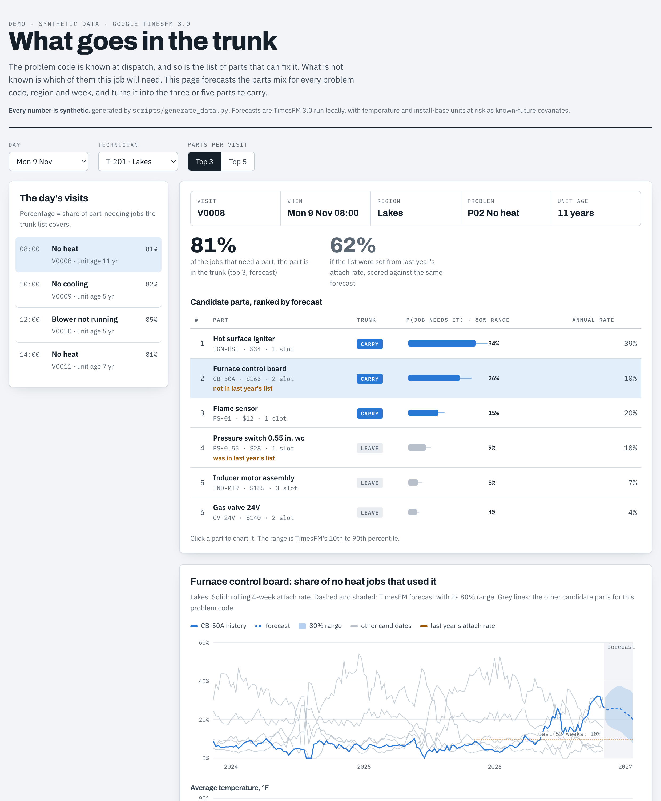

# Trunk Stock

**Which parts should the technician carry to this visit?**

A small, runnable demo of using Google's **TimesFM 3.0** time-series foundation model to choose the
three or five parts a field technician puts in the trunk for a dispatched job. It uses plain CSV
files, a few hundred lines of Python, and one static HTML page.

**Live demo:** https://kannanbalakrishnan576.github.io/trunk-stock/

> Every number in `data/` is synthetic, generated by `scripts/generate_data.py`. The repo shows a
> method. It is not evidence about any real service operation.



## The problem, and the assumptions

When a job is dispatched:

1. **The problem code is known.** Examples: "no heat", "no cooling", "water at indoor unit".
2. **The candidate parts for that problem are known.** A no-heat job on a gas furnace might need an
   igniter, a flame sensor, an inducer motor, a pressure switch, a control board or a gas valve.
3. **Which of those parts this job will need is not known.** Space in the trunk is limited, so you
   carry the most likely three, or five.

Point 3 is a forecasting problem, and the answer moves over time. Igniters crack in the first cold
weeks of the season. Capacitors fail in heat waves. A cohort of furnaces installed the same year
reaches the age where control boards fail. A bad batch from a supplier shows up as a spike. Van stock set
from last year's attach rate lags every one of these changes.

## What it does

```
history: jobs and parts used per week,    ┐
         region and problem code          │   TimesFM 3.0         P(job needs part)      top-k
weather: observed, then forecast          ├─► multivariate   ─►   per problem, region,  ─► trunk list
install base: units in a failure window   ┘   forecast            week, with 80% range     per visit
```

- **The target is the parts mix, not the parts volume.** For each region and problem code, the targets
  are the rolling 4-week attach rates of every candidate part: the share of jobs that used it. These
  are forecast jointly, as one multivariate series.
- **Known-future covariates** are average temperature and *units at risk*. Units at risk is the number of installed
  units inside a known failure window. Install dates are recorded, so this is known in advance.
- **The trunk list** for a visit is the top-k parts by forecast probability for that problem code,
  region and week.
- **A day's trunk** merges the visits on one route. One part covers every visit that wants it.

## Run it

The page and the scoring scripts use the standard library only.

```bash
python3 -m http.server 8000      # then open http://localhost:8000
```

To rebuild everything from scratch:

```bash
python3 scripts/generate_data.py            # the synthetic CSVs
pip install -r requirements.txt             # TimesFM 3.0, MLX backend (Apple silicon)
python3 forecast_timesfm.py                 # data/forecast.csv  (about 30 s once the weights are cached)
python3 backtest.py                         # data/backtest*.csv and calibration.csv
python3 recommend.py -k 5                   # trunk lists in the terminal
python3 recommend.py --tech T-201 --date 2026-11-09
```

On a machine other than Apple silicon, install `timesfm[torch]` instead and run with `--backend torch`.
The first run downloads the TimesFM 3.0 weights (330M parameters) from Hugging Face.

## Data

| File | One row per | Notes |
|---|---|---|
| `problem_codes.csv` | problem code | 4 codes |
| `parts.csv` | part | cost, trunk slots |
| `problem_parts.csv` | (problem, candidate part) | the known candidate list |
| `jobs_weekly.csv` | week × region × problem | 156 weeks, 3 regions |
| `part_usage_weekly.csv` | week × region × problem × part | jobs fixed without a part are not listed |
| `weather_weekly.csv` | week × region | observed for history, `forecast` for the next 12 weeks |
| `install_base_weekly.csv` | week × region × problem | units at risk, including the future weeks |
| `visits.csv` | upcoming visit | 64 visits, 6 technicians, 9–11 Nov 2026 |
| `forecast.csv` | run × week × region × problem × part | p10 / p50 / p90 attach rate |
| `backtest*.csv`, `calibration.csv` | — | written by `backtest.py` |

Three changes in the parts mix are built into the synthetic history:
- **Lakes, no heat.** Furnace control boards rise from 7% to over 25% of jobs from spring 2026,
  as an install cohort ages.
- **Desert, no cooling.** A bad capacitor batch fails from July 2026.
- **Coastal, blower not running.** ECM modules from one build year start failing in 2026.

## What the backtest shows

This demo is a visual aid for a method. It is not a proof of concept, and nothing here is an
accuracy claim: the data is synthetic, and the changes in it were put there on purpose.

`backtest.py` is included so the mechanics are complete, and so you can see what happens when a
parts list stops being refreshed. It runs a rolling backtest over 26 weeks. Each week, every method
sees only the earlier weeks and picks next week's list. The score is the share of jobs needing a
part where that part was in the trunk.

| Carrying 3 parts | Last year's attach rate | Last 8 weeks' attach rate | TimesFM 3.0 |
|---|---|---|---|
| All regions and problems | 81.0% | 81.8% | 81.8% |
| Lakes, no heat (the mix moved) | 63% | 77% | 78% |

What this illustrates, on this synthetic data:

- **A list that is never refreshed falls behind where the mix moves.** Methods that kept up
  recovered the gap.
- **A plain 8-week average keeps up about as well as the forecast here.** The changes built into
  the data are gradual. What the foundation model adds is that it scales without a model per
  series, takes known conditions as inputs, and gives a range. `calibration.csv` shows how often
  that range held.

Two modelling choices are documented in the code:

1. **Forecast the mix, not the volume.** The target is each part's share of jobs, not its count.
2. **Backtest the way it would run.** Re-forecast every week, one week ahead.

## Production: BigQuery

The TimesFM 3.0 open weights are under Google's **non-commercial licence**. This demo is
non-commercial. For production use, Google licenses the same model through BigQuery's
`AI.FORECAST`. Multivariate forecasting with covariates was in Preview as of October 2026.

```bash
bash bigquery/load.sh                                          # CSVs -> dataset `trunk`
python3 bigquery/make_sql.py                                   # one query per problem code
bq query --use_legacy_sql=false < bigquery/forecast_P02.sql
```

The query uses the same targets, covariates and horizon as the local script:

```sql
SELECT * FROM AI.FORECAST(
  TABLE data,
  model => 'TimesFM 3.0',
  timestamp_col => 'week',
  id_cols => ['region'],
  target_cols => ['ign_hsi', 'fs_01', 'ind_mtr', 'ps_0_55', 'cb_50a', 'gv_24v'],
  future_covariate_cols => ['avg_temp_f', 'units_at_risk'],
  horizon => 12,
  confidence_level => 0.8);
```

The BigQuery queries are written against Google's `AI.FORECAST` reference but **have not been run
as part of this repo**.

## Not in scope

- **Jobs that need two parts.** Each synthetic job consumes at most one part.
- **Cost-aware selection.** A cheap, one-slot part ranked sixth may be worth carrying. A natural next
  step is to rank by expected cost of a second visit avoided per trunk slot, using the p90.
- **Visit-level signals.** These include unit age, model, and the customer's description. The
  forecast here is per problem code, region and week. Conditioning on the unit belongs in the next
  layer.

## Licence

Code: Apache-2.0. TimesFM 3.0 weights: Google's TimesFM non-commercial licence. They are not
included here, and are downloaded at run time.
